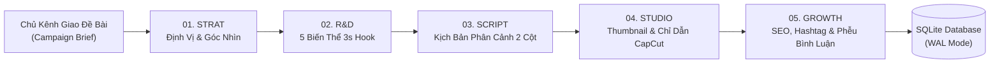

<div align="center">

# ChannelCorp OS — Autonomous Multi-Agent Media Agency

**Hệ Điều Hành Công Ty Truyền Thông Đa Phòng Ban AI Phục Vụ Xây Kênh (TikTok / YouTube / Reels)**

[](https://nodejs.org/)
[](https://www.sqlite.org/)
[](#)
[](https://opensource.org/licenses/MIT)

*Được thiết kế & phát triển bởi [Quốc Tuấn (@quoctuan364)](https://github.com/quoctuan364)*

</div>

---

## Tổng quan Hệ thống (System Overview)

**ChannelCorp OS** mô phỏng toàn bộ quy trình vận hành của một **Agency Truyền thông & Sản xuất Nội dung chuyên nghiệp** với **5 Phòng Ban** và **9 Nhân Sự AI chuyên trách**. Thay vì sử dụng các câu lệnh rời rạc, chủ kênh chỉ cần giao 1 đề bài (Campaign Brief), dây chuyền 5 phòng ban sẽ tự động bàn giao trọn bộ hồ sơ sản xuất:

1. **`[01 · STRAT]` Ban Chiến lược & Điều hành** (`DIR-01 Minh Quân`): Định vị góc tiếp cận độc bản (Unique Angle), phân tích nỗi đau tệp khán giả mục tiêu.
2. **`[02 · R&D]` Phòng Nghiên cứu Xu hướng & Hook Lab** (`TRD-02 Hải Yến`, `HOK-03 Tuấn Kiệt`): Thiết kế 5 phương án câu mở đầu giữ chân 3 giây đầu tiên (Visual & Verbal Hooks).
3. **`[03 · SCRIPT]` Phòng Biên kịch Phân cảnh** (`SCR-04 Bảo Ngọc`, `SCR-05 Hoàng Bách`): Xây dựng kịch bản 2 cột (Hình ảnh / B-Roll & Lời thoại Voiceover) chuẩn nhịp độ TikTok/Reels 60s hoặc YouTube dài.
4. **`[04 · STUDIO]` Phòng Đạo diễn Hình ảnh & Hậu kỳ CapCut** (`VIS-06 Khánh Linh`, `EDT-07 Đức Anh`): Thiết kế bố cục Thumbnail CTR cao, chỉ dẫn nhịp cắt Jump-cut, hiệu ứng âm thanh (SFX) và phụ đề động.
5. **`[05 · GROWTH]` Phòng Tăng trưởng, SEO & Chuyển đổi** (`SEO-08 Phương Thảo`, `BIZ-09 Gia Huy`): Tối ưu tiêu đề A/B Testing, bộ Hashtag phân tầng, khung giờ đăng và kịch bản ghim bình luận điều hướng khách hàng.

---

## Kiến trúc Dây chuyền Đa Phòng Ban (Multi-Agent Pipeline)



---

## Hướng dẫn Khởi chạy Nhanh (Quick Start)

### Yêu cầu hệ thống
- **Node.js** phiên bản `>= 22.5.0` (hoặc `v24+` tích hợp sẵn `node:sqlite`).

### Chạy ứng dụng

```bash
# 1. Clone kho lưu trữ từ GitHub
git clone https://github.com/quoctuan364/channelcorp-os.git
cd channelcorp-os

# 2. Khởi chạy trực tiếp (Zero external dependencies)
node server/index.js
```

Hoặc nhấp đúp vào file **`start-channelcorp.bat`** trên Windows. Mở trình duyệt tại:
`http://localhost:4322`

---

## Đặc tả RESTful API (API Endpoints)

| Phương thức | Endpoint | Mô tả chức năng |
| :--- | :--- | :--- |
| `GET` | `/api/company` | Truy xuất toàn bộ sơ đồ 5 phòng ban, 9 nhân sự AI, danh sách chiến dịch và biên bản họp |
| `POST` | `/api/campaigns/generate` | Kích hoạt dây chuyền 5 phòng ban tự động sản xuất trọn bộ hồ sơ kịch bản & hậu kỳ |
| `POST` | `/api/agents/consult` | Ra lệnh hoặc hỏi trực tiếp 1-1 với bất kỳ chuyên viên AI nào trong phòng họp |
| `PUT` | `/api/campaigns/:id` | Cập nhật trạng thái sản xuất (`SCRIPTING` → `VISUAL` → `READY`) trên bảng Kanban |
| `DELETE` | `/api/campaigns/:id` | Xóa chiến dịch khỏi cơ sở dữ liệu |

---

## Giấy phép (License)

Dự án được phân phối dưới giấy phép **MIT License**. Phát triển bởi **[Quốc Tuấn (@quoctuan364)](https://github.com/quoctuan364)**.
